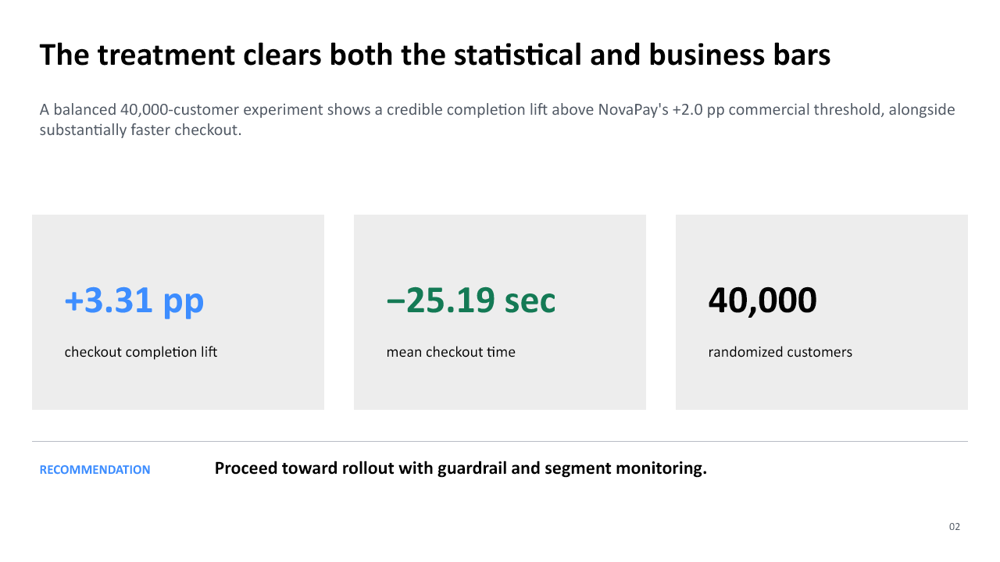

<p align="center">
  
</p>

# Decision Analytics Case Studies

[](https://github.com/laura-rivera-sancho/analytics-standard-framework/actions/workflows/ci.yml)

**Reproducible decision work for experiments, launches, targeting, KPI diagnosis, customer value, and marketing measurement.**

[Review the case studies](#demonstration-evidence-by-decision) · [Inspect the source workflows](01_ab_testing/src) · [Contact Laura](mailto:laura.riverasancho33@gmail.com)

This repository shows how I turn a high-value business question into a validated analysis, an evidence-calibrated recommendation, and an executive readout. It is designed for product, growth, operations, customer, and analytics leaders who need a defensible answer—not another dashboard without a decision.

[](01_ab_testing/reports/stakeholder_readout.md)

*Synthetic demonstration evidence—[read the decision memo](01_ab_testing/reports/stakeholder_readout.md) or [review the full set of case studies](#demonstration-evidence-by-decision).*

## The decisions this work supports

| Situation | Decision |
|---|---|
| Product or process experiment | Roll out, iterate, stop, or gather more evidence |
| AI or automation launch | Continue scaling, pause, roll back, or change monitoring |
| Limited outreach capacity | Define eligibility and decide who should be prioritized |
| Unexpected KPI movement | Identify the most credible driver and the next controlled action |
| Customer-value concentration | Decide where retention attention and measurement should focus |
| Marketing treatment test | Advance a treatment, redesign the test, or contain rollout |
| Market relationship shift | Decide whether a change warrants deeper cited research |

## Analytics engagement at a glance

| Item | Typical scope |
|---|---|
| **Best for** | Teams facing a consequential KPI, experiment, launch, targeting, or customer decision |
| **Duration** | 2–3 weeks for a focused analysis or experiment-design sprint |
| **Inputs** | Decision and available options; data extracts and metric definitions; assignment or intervention timing; known operational changes; decision owner and subject-matter reviewers |
| **Phase 1** | Define the decision, analytical population, timing, metrics, exclusions, comparison design, and causal limits |
| **Phase 2** | Validate data, execute the analysis, test assumptions, quantify uncertainty, and review important segments |
| **Phase 3** | Translate findings into business impact, deliver the executive readout, and define monitoring or next evidence |
| **Buyer receives** | Decision and metric contract, validation findings, reproducible analysis, effect and uncertainty assessment, executive memo or presentation, and follow-up measurement plan |
| **Not included** | Unsupported causal claims, new data collection, production dashboard engineering, long-term data-platform work, or ongoing reporting after handoff |

## Acceptance criteria

A focused engagement should end with:

- documented population, timing, metrics, assumptions, and exclusions;
- reconciliation between source records and reported results;
- effect size, uncertainty, practical significance, and limitations reported together;
- exploratory findings clearly separated from confirmatory evidence;
- a recommendation tied to an owner and decision date; and
- a monitoring or next-evidence plan that makes the following decision explicit.

## Start with the executive evidence

| Decision capability | Finished artifact |
|---|---|
| Randomized product decision | [NovaPay A/B testing readout](01_ab_testing/reports/stakeholder_readout.md) |
| Observational launch assessment | [FinFlow launch-impact readout](02_pre_post_analysis/reports/stakeholder_readout.md) |
| Eligibility and capacity allocation | [LuminaPay targeting readout](03_target_analysis/reports/stakeholder_readout.md) |
| Time-bounded KPI diagnosis | [OrbitMart diagnostic readout](04_ad_hoc_analysis/reports/stakeholder_readout.md) |
| Customer value and lifecycle | [Harbor & Pine lifecycle readout](05_customer_value_lifecycle/reports/stakeholder_readout.md) |
| Marketing experiment selection | [Harbor & Pine experimentation readout](06_marketing_experimentation/reports/stakeholder_readout.md) |
| Live market-context monitoring | [Macro Correlation Monitor](07_macro_correlation_monitor/README.md) |

## Demonstration boundary

The companies, datasets, and results in this repository are fictional or synthetic unless a source is explicitly identified as live. They demonstrate analytical judgment, reproducibility, validation, and stakeholder communication; they are not client results or guarantees of business impact.

## How an engagement would start

1. Identify the decision, options, audience, deadline, and decision owner.
2. Review the available data, metric definitions, timing, and known operational changes.
3. Confirm the written scope, comparison design, deliverables, acceptance criteria, exclusions, and causal limits.
4. Begin once access, ownership, and review expectations are agreed.

For an initial scope discussion, [email Laura](mailto:laura.riverasancho33@gmail.com) with the decision you need to make, the available data, and the target timeline.

## Demonstration evidence by decision

| Case study | Business decision | Analytical approach | Portfolio evidence |
|---|---|---|---|
| **NovaPay** | Should a simplified checkout experience be rolled out? | Randomized A/B test | [Finished stakeholder readout](01_ab_testing/reports/stakeholder_readout.md): **+3.31 pp** completion lift, 95% CI **+2.45 to +4.17 pp**, with materially lower checkout time. |
| **FinFlow** | Should an automated verification workflow continue scaling? | Pre/Post analysis and adjusted interrupted time series | [Finished stakeholder readout](02_pre_post_analysis/reports/stakeholder_readout.md): **+5.65 pp** observed completion change and **+3.20 pp** adjusted launch-level estimate, with moderate causal confidence. |
| **LuminaPay** | Which eligible merchants should receive limited Instant Settlement outreach? | Rule-based target analysis and capacity sensitivity | [Finished stakeholder readout](03_target_analysis/reports/stakeholder_readout.md): **25,805** eligible merchants and a controlled **6,000-contact** first wave with explicit activation safeguards. |
| **OrbitMart** | Why did checkout completion fall while traffic increased? | KPI-tree diagnosis, rate/mix decomposition, and controlled segment drill-down | [Finished stakeholder readout](04_ad_hoc_analysis/reports/stakeholder_readout.md): **−0.97 pp** completion decline localized to Android 8.4 wallet traffic, with an estimated **254-order** gap. |
| **Harbor & Pine** | Which customer groups create the most value, and where should limited retention capacity focus? | Point-in-time RFM scoring, lifecycle migration, and consent-aware prioritization | [Finished stakeholder readout](05_customer_value_lifecycle/reports/stakeholder_readout.md): Champions are **23.1%** of customers but **55.5%** of value; a controlled **500-customer** first wave represents **$323.2K** in trailing-year value. |
| **Harbor & Pine Experimentation** | Which retention treatment should advance without approving broad rollout? | Split test and `2 × 2 × 2` factorial experiment | [Finished stakeholder readout](06_marketing_experimentation/reports/stakeholder_readout.md): the leading cell improves conversion by **+2.67 pp** after Holm correction, while margin uncertainty requires a controlled validation stage. |
| **Macro Correlation Monitor** | When have gold's relationships with DXY and US10Y shifted enough to warrant deeper research? | Live API pipeline, rolling cross-asset correlation, and rules-based market context | [Interactive module](07_macro_correlation_monitor/README.md): selectable **30/90/252-day** views, exact source/freshness metadata, deterministic fallback behavior, and a governed handoff to later cited LLM and Agentic AI layers. |

## Technical reference modules

| Module | Status | Focus | Start here |
|---|---|---|---|
| `01_ab_testing` | Complete | Controlled experiments and causal product or process decisions | [A/B Testing](01_ab_testing/README.md) |
| `02_pre_post_analysis` | Complete | Impact analysis when randomized control is unavailable | [Pre/Post Analysis](02_pre_post_analysis/README.md) |
| `03_target_analysis` | Complete | Eligibility, segmentation, opportunity sizing, prioritization, and activation handoff | [Target Analysis](03_target_analysis/README.md) |
| `04_ad_hoc_analysis` | Complete | Structured, time-bounded KPI diagnosis and decision handoff | [Ad Hoc Analysis](04_ad_hoc_analysis/README.md) |
| `05_customer_value_lifecycle` | Complete | RFM segmentation, lifecycle migration, value concentration, and controlled retention activation | [Customer Value & Lifecycle](05_customer_value_lifecycle/README.md) |
| `06_marketing_experimentation` | Complete | Split testing, factorial multivariate testing, interaction effects, multiplicity, and rollout governance | [Marketing Experimentation Suite](06_marketing_experimentation/README.md) |
| `07_macro_correlation_monitor` | Complete | Live gold–US10Y–DXY monitoring, rolling correlations, source governance, and regime-aware interpretation | [Macro Correlation Monitor](07_macro_correlation_monitor/README.md) |

## Repository map

```text
analytics-standard-framework/
├── 01_ab_testing/
│   ├── case_study/      # NovaPay business case, data dictionary, and reference results
│   ├── data/raw/        # Compact synthetic sample
│   ├── notebooks/       # Reproducible analysis notebook
│   ├── reports/         # Finished Markdown readout, preview, and PowerPoint deck
│   ├── src/             # Data generator and reference analysis
│   └── templates/       # Experiment planning, validation, and stakeholder readout
├── 02_pre_post_analysis/
│   ├── case_study/      # FinFlow business case and data dictionary
│   ├── data/raw/        # Compact synthetic sample
│   ├── notebooks/       # Reproducible analysis notebook
│   ├── reports/         # Finished Markdown readout, preview, and PowerPoint deck
│   ├── src/             # Data generator and Pre/Post/ITS analysis
│   └── templates/       # Reference findings, acceptance checklist, and reusable template
├── 03_target_analysis/
│   ├── case_study/      # LuminaPay decision, dictionary, and expected results
│   ├── data/raw/        # Compact synthetic merchant sample
│   ├── notebooks/       # Reproducible targeting analysis
│   ├── reports/         # Finished Markdown readout, preview, and PowerPoint deck
│   ├── src/             # Synthetic data, eligibility, sizing, and prioritization
│   └── templates/       # Reference findings, acceptance checklist, and activation readout
├── 04_ad_hoc_analysis/
│   ├── case_study/      # OrbitMart diagnostic case, dictionary, and results
│   ├── data/raw/        # Compact synthetic checkout sample
│   ├── notebooks/       # Reproducible diagnostic analysis
│   ├── reports/         # Finished Markdown readout, preview, and PowerPoint deck
│   ├── src/             # Synthetic data, KPI tree, decomposition, and inference
│   └── templates/       # Intake brief, reference findings, acceptance checklist, and readout
├── 05_customer_value_lifecycle/
│   ├── case_study/      # Harbor & Pine decision, dictionary, and reference results
│   ├── data/raw/        # Compact synthetic customer-order sample
│   ├── notebooks/       # Reproducible lifecycle analysis
│   ├── reports/         # Finished Markdown readout, preview, and PowerPoint deck
│   ├── src/             # Synthetic data, RFM, migration, prioritization, and visualization
│   └── templates/       # Reusable lifecycle stakeholder readout
├── 06_marketing_experimentation/
│   ├── case_study/      # Harbor & Pine charter, dictionary, and reference results
│   ├── data/raw/        # Compact synthetic split-test and factorial-assignment sample
│   ├── notebooks/       # Reproducible experimentation analysis
│   ├── reports/         # Finished Markdown readout, preview, and PowerPoint deck
│   ├── src/             # Generator, validation, analysis, and visualization
│   └── templates/       # Reusable experiment stakeholder readout
├── 07_macro_correlation_monitor/
│   ├── case_study/      # Exact market-data source contract and limitations
│   ├── reports/         # Research-oriented stakeholder readout
│   ├── site/            # Live Sites dashboard and market-data API route
│   └── src/             # Tested alignment, transformation, and risk utilities
├── ROADMAP.md            # Cross-portfolio evidence and readiness map
└── README.md             # Portfolio landing page
```

## Quick start

### Requirements

- Python 3.11 or 3.12
- `pip`
- Jupyter for the reproducible analysis notebooks
- Node.js only for the optional reusable PowerPoint template generators

### Run an analysis

Clone the repository and choose a module:

```bash
git clone https://github.com/laura-rivera-sancho/analytics-standard-framework.git
cd analytics-standard-framework/01_ab_testing

python -m venv .venv
source .venv/bin/activate  # Windows PowerShell: .venv\Scripts\Activate.ps1
pip install -r requirements.txt

python src/generate_synthetic_data.py
python src/analyze_experiment.py
```

All completed modules use the same pinned root environment. From the repository root, install the full runtime with:

```bash
pip install -r requirements.txt
```

For tests and linting:

```bash
pip install -r requirements-dev.txt
ruff check .
pytest
```

Open the reproducible analysis notebook:

```bash
jupyter notebook notebooks/reproducible_analysis.ipynb
```

Equivalent instructions and module-specific assumptions are documented in each module README.

## Delivery methodology

1. Frame the business problem and decision.
2. Define the analytical question and hypothesis.
3. Specify the population, scope, and unit of analysis.
4. Define data requirements and success metrics before reading outcomes.
5. Validate data quality and analytical integrity.
6. Select and execute the appropriate method.
7. Quantify uncertainty, effect size, and practical significance.
8. Investigate segments, assumptions, and alternative explanations.
9. Translate findings into business impact.
10. Recommend an action with limitations and a monitoring plan.
11. Document the work for reproducibility and handoff.

## Design principles

- Start with the business decision, not the statistical technique.
- Define hypotheses and success metrics before reading outcomes.
- Validate data and experiment or model integrity before interpretation.
- Separate statistical significance from business significance.
- Treat exploratory findings as hypotheses when appropriate.
- Make assumptions, exclusions, and limitations explicit.
- End every analysis with a clear recommendation and decision path.

## Data and privacy

All companies, scenarios, customer identifiers, datasets, and results in this repository are fictional or synthetically generated to make the analytical workflows reproducible. They do not represent confidential information from any employer or client, and demonstration results are not claims about real business outcomes.

## Contributing and reuse

Contributions that improve analytical rigor, reproducibility, documentation, or
accessibility are welcome. Review [CONTRIBUTING.md](CONTRIBUTING.md) for the
module standard, synthetic-data policy, local checks, and pull request workflow.

This project is available under the [MIT License](LICENSE). If you reference the
framework in academic or professional work, GitHub can generate a citation from
the repository's [citation metadata](CITATION.cff).
